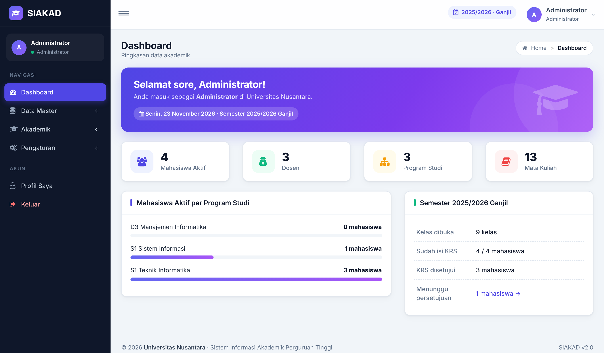
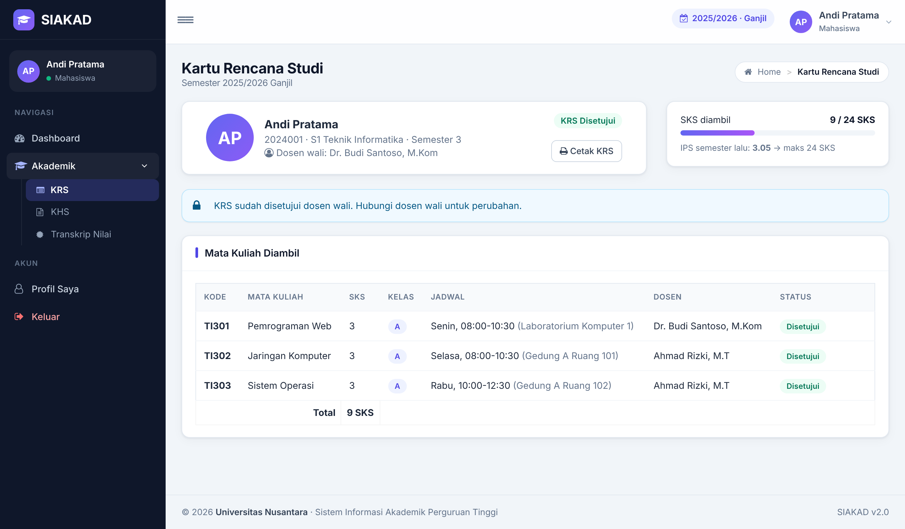
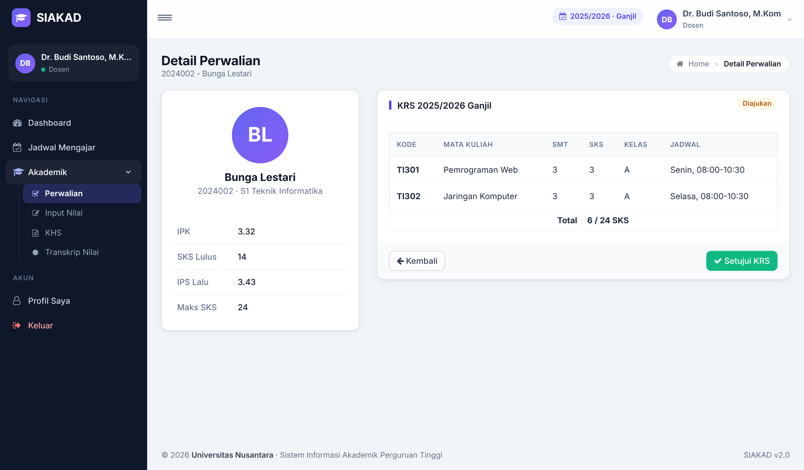
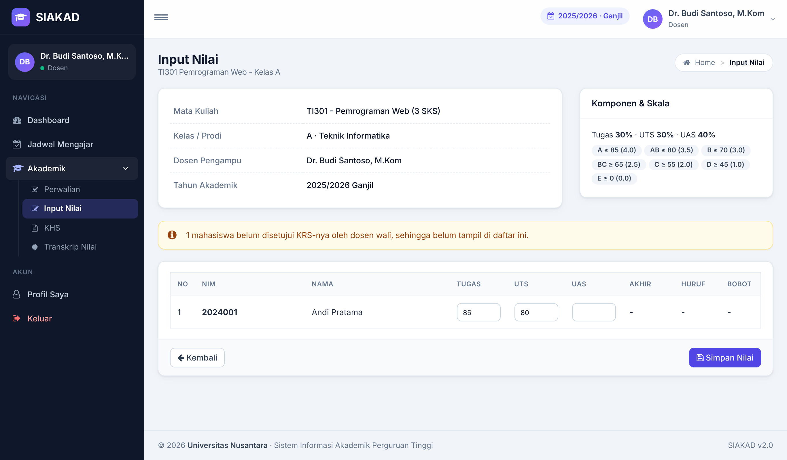
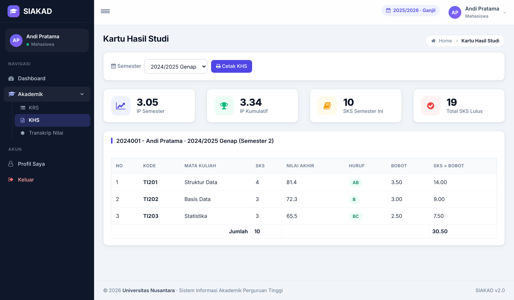
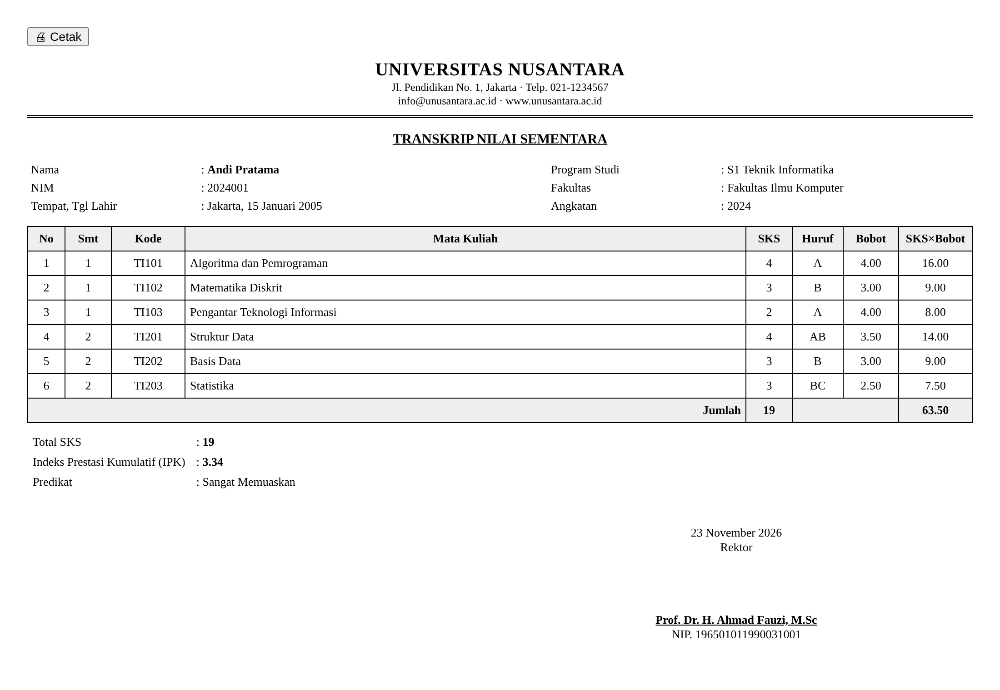

# Latihan 2a : SIAKAD Perguruan Tinggi

SIAKAD adalah sistem informasi akademik kampus yang dibuat dengan CodeIgniter 3. Aplikasi ini memiliki tiga jenis
pengguna, yaitu administrator, dosen, dan mahasiswa. Fitur utamanya adalah pengisian KRS, perwalian, input nilai, KHS,
dan transkrip nilai.



## Fitur

### Data Master

Administrator mengelola data mahasiswa, dosen, program studi, mata kuliah, ruangan, dan tahun akademik. Data mahasiswa
menyimpan NIM, angkatan, status, dosen wali, dan foto. Saat menambah mahasiswa, akun login bisa langsung dibuat dengan
username dan password berupa NIM. Tahun akademik yang aktif hanya boleh satu.

### Jadwal Kuliah

Administrator membuat jadwal kuliah per semester yang berisi mata kuliah, kelas, dosen, ruangan, hari, jam, dan kuota.
Jadwal yang bentrok, baik dari sisi dosen maupun ruangan, akan ditolak.

### Kartu Rencana Studi (KRS)

Mahasiswa memilih mata kuliah dari jadwal yang tersedia untuk program studinya. Saat memilih, sistem mengecek apakah
jadwalnya bentrok, kuota kelas sudah penuh, atau jumlah SKS melebihi batas. KRS yang sudah disetujui dosen wali tidak
bisa diubah lagi oleh mahasiswa.



### Perwalian

Dosen wali melihat daftar mahasiswa bimbingannya dan memeriksa KRS masing-masing beserta IPK, IPS semester lalu, dan
batas SKS. Jika sudah sesuai, dosen wali menyetujui KRS tersebut.



### Input Nilai

Dosen pengampu menginput nilai tugas, UTS, dan UAS untuk kelas yang diajarnya. Nilai akhir dihitung dengan bobot 30%
tugas, 30% UTS, dan 40% UAS, lalu otomatis dikonversi menjadi nilai huruf dan bobotnya.



### KHS dan Transkrip

Mahasiswa dapat melihat Kartu Hasil Studi setiap semester yang berisi IPS, IPK, dan jumlah SKS. Transkrip menampilkan
seluruh mata kuliah yang sudah dinilai beserta IPK dan predikatnya. KRS, KHS, dan transkrip bisa dicetak dengan kop
kampus.





### Pengaturan

Administrator dapat mengelola user, level user, menu, hak akses menu untuk setiap level, dan informasi kampus.

## Hak Akses

| Pengguna | Yang bisa dilakukan |
|---|---|
| Administrator | Membuka semua menu dan mengelola KRS mahasiswa mana pun |
| Dosen | Melihat jadwal mengajar, menginput nilai kelas yang diajar, serta melihat perwalian, KHS, dan transkrip mahasiswa bimbingannya |
| Mahasiswa | Mengisi KRS sendiri serta melihat KHS dan transkrip sendiri |

## Aturan Akademik

Nilai akhir dihitung dari 30% tugas, 30% UTS, dan 40% UAS, kemudian dikonversi menjadi nilai huruf.

| Nilai akhir | Huruf | Bobot |
|---|---|---|
| 85 - 100 | A | 4,0 |
| 80 - 84 | AB | 3,5 |
| 70 - 79 | B | 3,0 |
| 65 - 69 | BC | 2,5 |
| 55 - 64 | C | 2,0 |
| 45 - 54 | D | 1,0 |
| 0 - 44 | E | 0 |

Batas SKS yang boleh diambil ditentukan dari IPS semester sebelumnya.

| IPS semester lalu | Maksimal SKS |
|---|---|
| 3,00 ke atas | 24 |
| 2,50 - 2,99 | 21 |
| 2,00 - 2,49 | 18 |
| di bawah 2,00 | 15 |
| Mahasiswa baru | 20 |

IPK dihitung dari nilai terbaik setiap mata kuliah, jadi mata kuliah yang diulang hanya dihitung satu kali. Aturan-aturan
ini ada di file `application/helpers/siakad_helper.php`.

## Alur Penggunaan

1. Administrator membuat tahun akademik baru dan mengaktifkannya.
2. Administrator membuat jadwal kuliah untuk semester tersebut.
3. Mahasiswa mengisi KRS.
4. Dosen wali memeriksa dan menyetujui KRS.
5. Dosen pengampu menginput nilai.
6. Mahasiswa melihat dan mencetak KHS serta transkrip.

## Instalasi (XAMPP)

1. Salin folder `siakad` ke `C:\xampp\htdocs`.
2. Import file `database/db_siakad.sql` melalui phpMyAdmin.
3. Jika username atau password MySQL berbeda, ubah di `application/config/database.php`.
4. Buka `http://localhost/siakad`.

Aplikasi membutuhkan PHP 7.4 sampai 8.3, MySQL atau MariaDB, dan Apache dengan mod_rewrite aktif. File CSS dan
JavaScript sudah tersedia di folder `assets/vendor`.

## Akun Demo

Semua akun memakai password `123456`.

| Username | Pengguna | Keterangan |
|---|---|---|
| `admin` | Administrator | |
| `dosen` | Dr. Budi Santoso | Dosen wali dari Andi dan Bunga |
| `mahasiswa` | Andi Pratama (2024001) | Sudah memiliki nilai dua semester |

KRS milik Bunga (NIM 2024002) masih menunggu persetujuan, sehingga bisa dipakai untuk mencoba menu Perwalian.

## Struktur Folder

```
application/
├── core/MY_Controller.php      cek login, hak akses, dan CRUD umum
├── helpers/siakad_helper.php   fungsi nilai, IPK, batas SKS, dan lainnya
├── models/M_krs.php            KRS, nilai, KHS, dan transkrip
├── controllers/
└── views/
assets/
database/db_siakad.sql
docs/screenshots/
```
