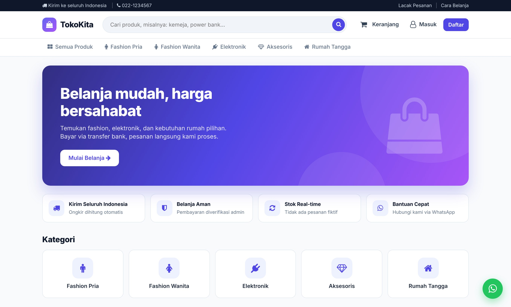
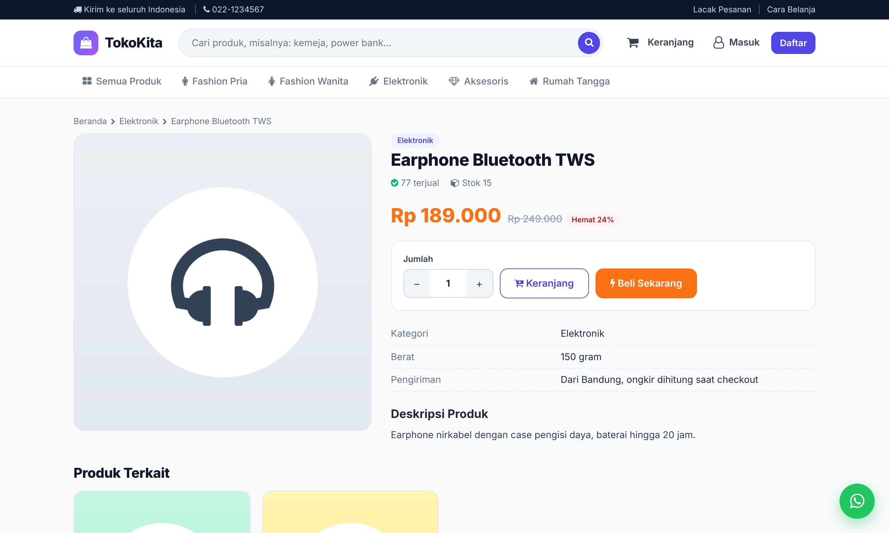
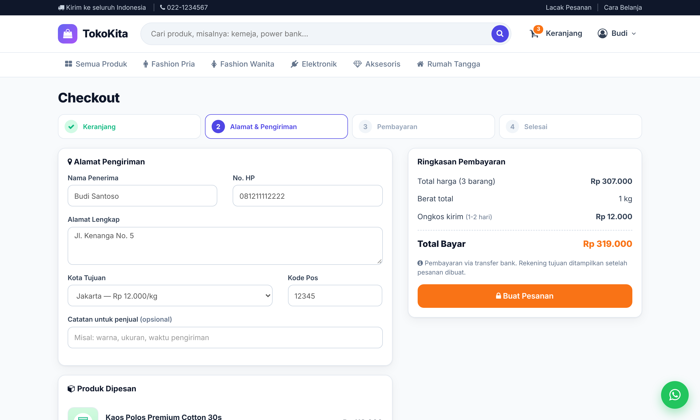
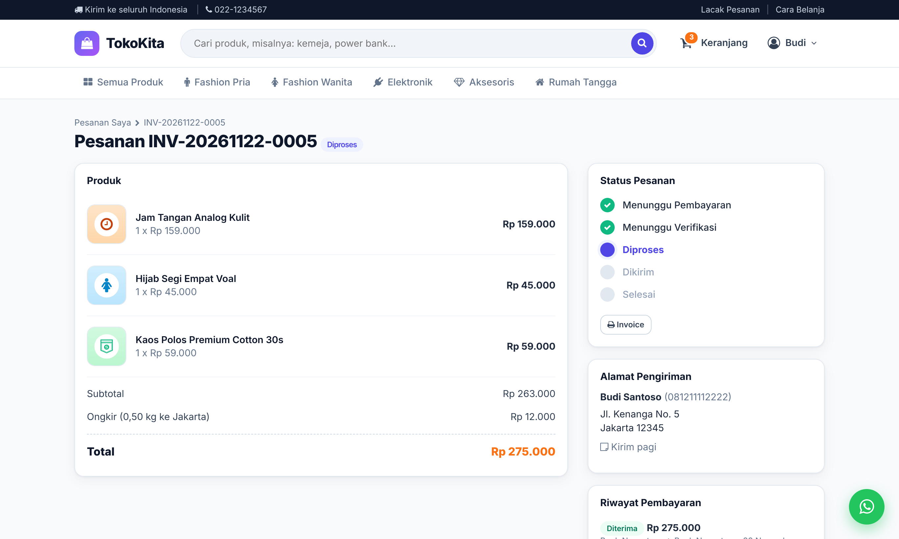
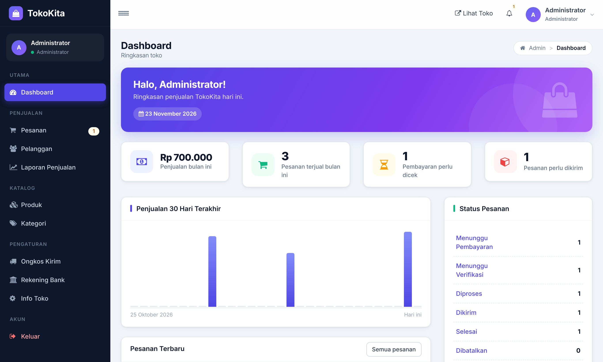
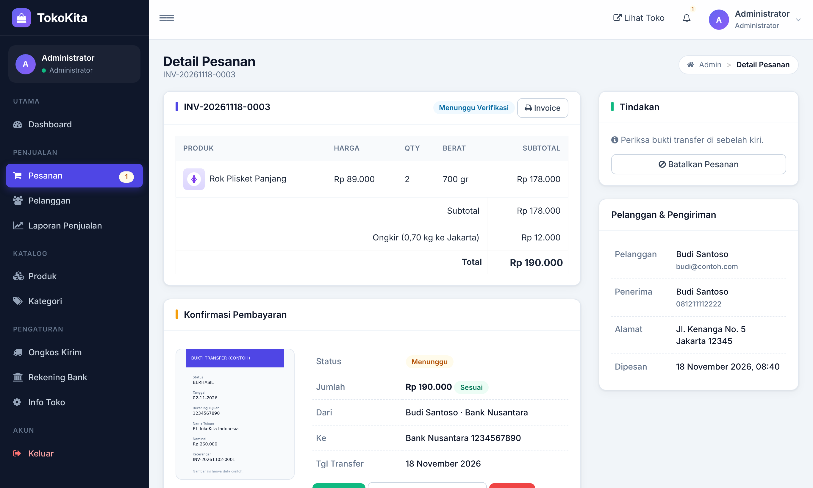

# Latihan 2b : TokoKita (Toko Online)

TokoKita adalah aplikasi toko online yang dibuat dengan CodeIgniter 3. Aplikasi ini memiliki dua bagian, yaitu halaman
toko untuk pelanggan dan panel admin untuk mengelola toko.



## Fitur Halaman Toko

### Beranda dan Katalog

Beranda menampilkan kategori, produk terlaris, dan produk terbaru. Di halaman katalog, produk bisa difilter berdasarkan
kategori, dicari dengan kata kunci, dan diurutkan berdasarkan produk terbaru, terlaris, atau harga.

### Detail Produk

Halaman detail menampilkan harga, harga coret jika sedang diskon, stok, berat, deskripsi, dan produk terkait. Dari
halaman ini pelanggan bisa memasukkan produk ke keranjang atau langsung membeli.



### Keranjang dan Checkout

Keranjang disimpan di session, sehingga pengunjung bisa memasukkan produk ke keranjang sebelum login. Isi keranjang tetap
ada setelah pengunjung login atau mendaftar. Jumlah produk di keranjang tidak bisa melebihi stok.

Saat checkout, pelanggan mengisi alamat pengiriman dan memilih kota tujuan. Ongkos kirim dihitung otomatis dari total
berat dan tarif per kilogram kota tujuan, dengan berat dibulatkan ke atas.



### Pesanan Saya

Setelah pesanan dibuat, pelanggan mentransfer ke rekening toko lalu mengunggah bukti transfer. Pelanggan dapat melihat
status pesanan, nomor resi, dan riwayat pembayaran, serta mencetak invoice. Pesanan yang belum dibayar masih bisa
dibatalkan.



## Fitur Panel Admin

### Dashboard

Dashboard menampilkan total penjualan bulan ini, grafik penjualan 30 hari terakhir, pesanan terbaru, jumlah pesanan per
status, dan produk yang stoknya hampir habis.



### Pesanan

Admin dapat melihat pesanan berdasarkan status dan tanggal. Pada detail pesanan, admin memeriksa bukti transfer lalu
menerima atau menolak pembayaran. Jika ditolak, pelanggan diminta mengunggah ulang bukti transfer. Setelah pembayaran
diterima, admin mengisi nomor resi saat pesanan dikirim.



### Menu Lainnya

| Menu | Keterangan |
|---|---|
| Produk | Tambah, edit, upload gambar, harga coret, stok, berat, dan status tampil |
| Kategori | Nama kategori dan ikon, slug dibuat otomatis |
| Pelanggan | Daftar pelanggan beserta jumlah pesanan dan total belanja |
| Laporan Penjualan | Penjualan per periode, produk terlaris, dan cetak laporan |
| Ongkos Kirim | Tarif per kilogram untuk setiap kota |
| Rekening Bank | Rekening tujuan transfer |
| Info Toko | Nama toko, alamat, kontak, dan nomor WhatsApp |

## Status Pesanan

| Status | Keterangan |
|---|---|
| Menunggu Pembayaran | Pesanan baru dibuat, pelanggan belum mengirim bukti transfer |
| Menunggu Verifikasi | Bukti transfer sudah dikirim dan menunggu dicek admin |
| Diproses | Pembayaran diterima, pesanan sedang disiapkan |
| Dikirim | Pesanan sudah dikirim dan nomor resi sudah diisi |
| Selesai | Pesanan sudah diterima pelanggan |
| Dibatalkan | Pesanan dibatalkan dan stok dikembalikan |

Jika pembayaran ditolak, status kembali ke Menunggu Pembayaran. Pesanan dapat dibatalkan selama belum dikirim.

## Aturan yang Diterapkan

Stok dicek ulang saat checkout di dalam transaksi database, sehingga produk tidak bisa terjual melebihi stok. Jika
pesanan dibatalkan, stok dikembalikan.

Nama dan harga produk disalin ke detail pesanan, sehingga riwayat pesanan tidak berubah meskipun data produk diedit.
Produk yang pernah dipesan tidak dihapus permanen, tetapi hanya dinonaktifkan.

Pelanggan hanya bisa melihat pesanan miliknya sendiri, dan halaman admin hanya bisa dibuka setelah login sebagai admin.

## Alur Belanja

1. Pelanggan memilih produk dan memasukkannya ke keranjang.
2. Pelanggan login atau mendaftar, lalu mengisi alamat saat checkout.
3. Pelanggan mentransfer pembayaran dan mengunggah bukti transfer.
4. Admin memverifikasi pembayaran, lalu pesanan diproses.
5. Admin mengirim pesanan dan mengisi nomor resi.
6. Pelanggan atau admin menandai pesanan selesai.

## Instalasi (XAMPP)

1. Salin folder `toko_kita` ke `C:\xampp\htdocs`.
2. Import file `database/db_tokoonline.sql` melalui phpMyAdmin.
3. Jika username atau password MySQL berbeda, ubah di `application/config/database.php`.
4. Pastikan folder `uploads/produk` dan `uploads/bukti` bisa ditulisi.
5. Buka `http://localhost/toko_kita` untuk halaman toko dan `http://localhost/toko_kita/admin` untuk panel admin.

Aplikasi membutuhkan PHP 7.4 sampai 8.3, MySQL atau MariaDB, dan Apache dengan mod_rewrite aktif.

## Akun Demo

| Pengguna | Login | Password |
|---|---|---|
| Admin | `admin` (di `/admin`) | `123456` |
| Pelanggan | `budi@contoh.com` | `123456` |
| Pelanggan | `siti@contoh.com` | `123456` |

Data contoh berisi 12 produk dan 5 pesanan dengan status yang berbeda. Pesanan INV-20261118-0003 sedang menunggu
verifikasi, sehingga bisa dipakai untuk mencoba fitur verifikasi pembayaran. Gambar produk dan bukti transfer pada data
contoh hanya ilustrasi.

## Struktur Folder

```
application/
├── core/MY_Controller.php         controller dasar untuk toko, pelanggan, dan admin
├── libraries/Keranjang_lib.php    keranjang belanja
├── helpers/toko_helper.php        format rupiah, ongkir, status pesanan, dan lainnya
├── models/M_pesanan.php           pembuatan pesanan, status, dan laporan
├── controllers/                   halaman toko
├── controllers/admin/             panel admin
└── views/
assets/
database/db_tokoonline.sql
uploads/
docs/screenshots/
```
